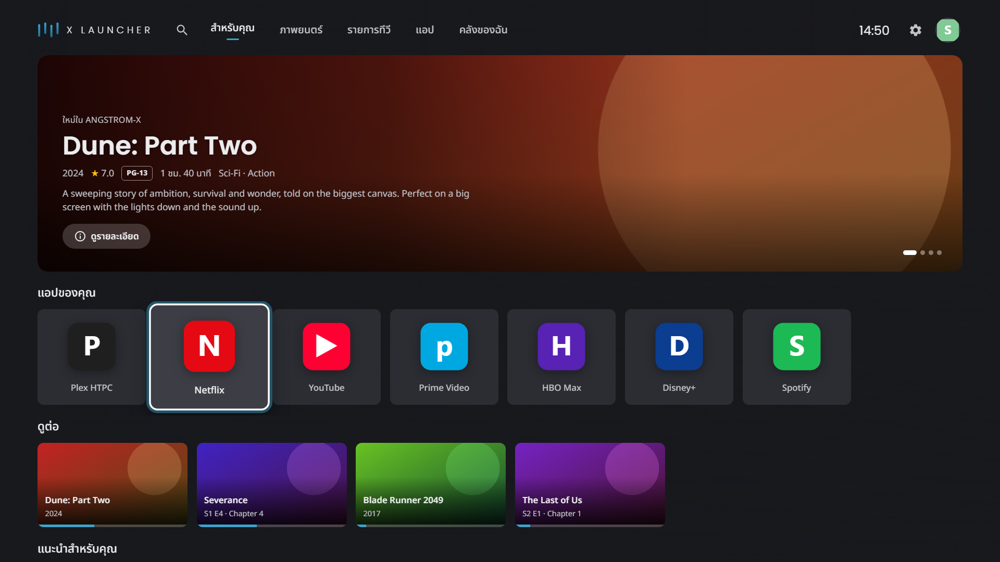
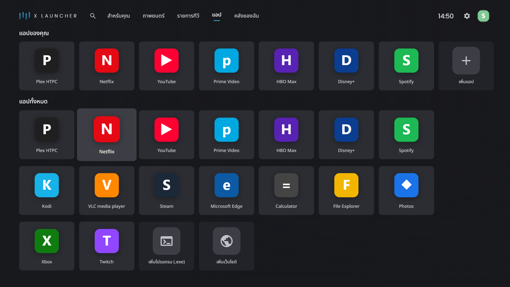
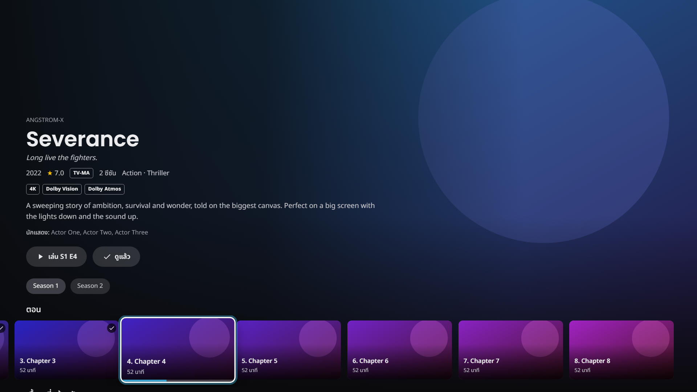
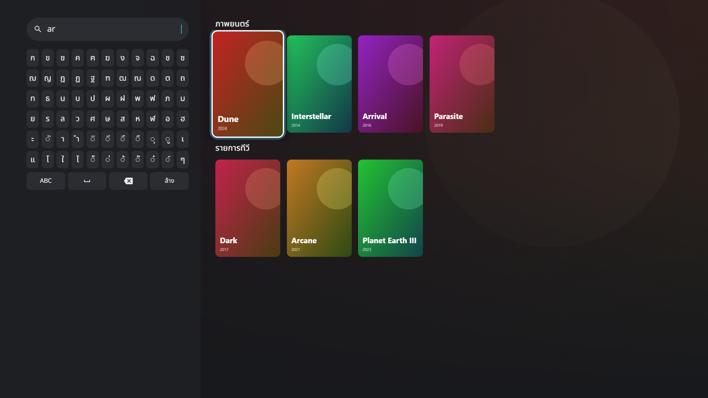
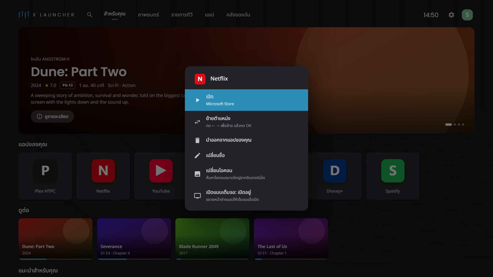
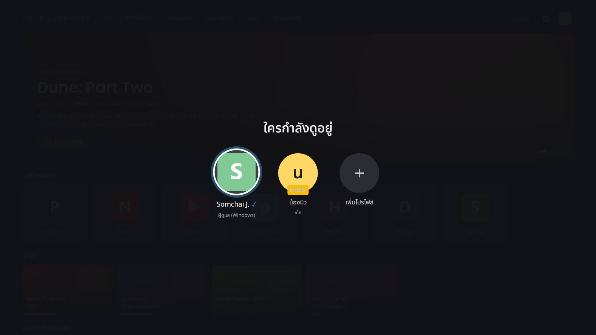
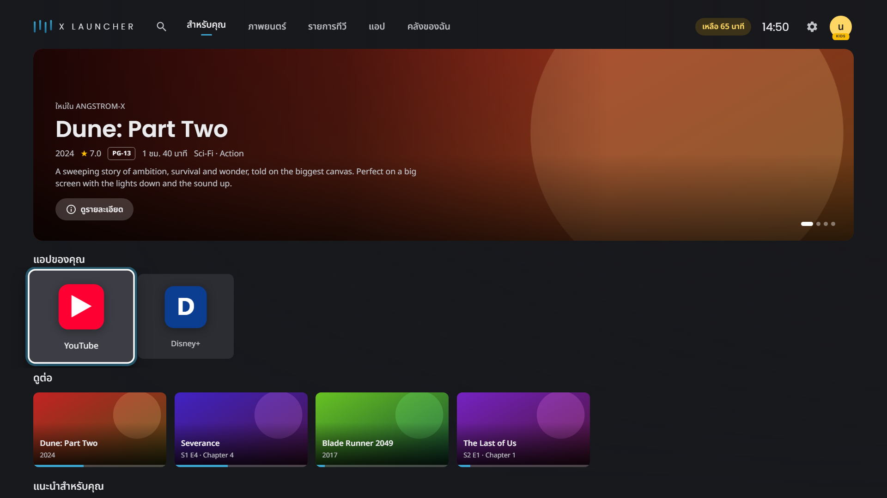
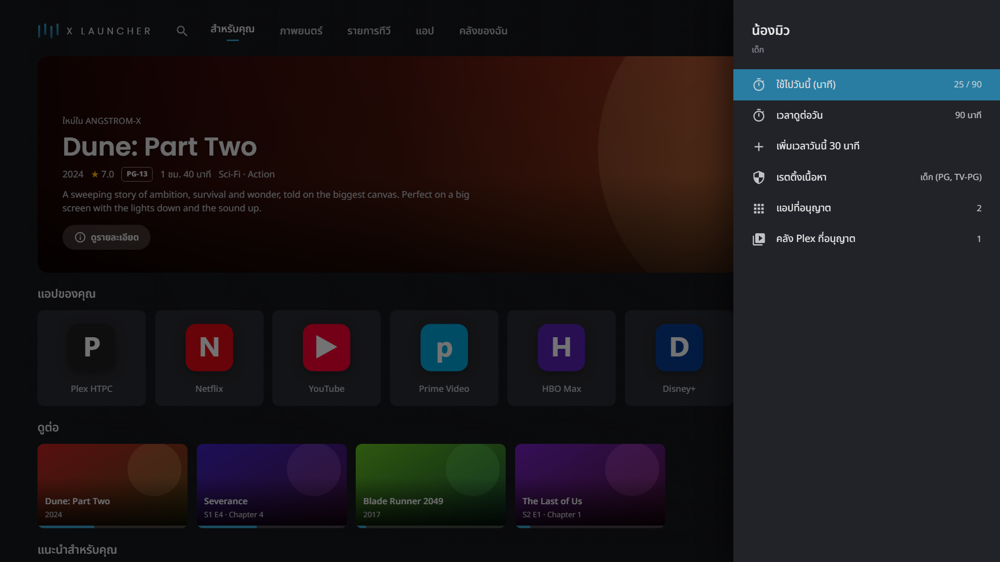

<p align="center"></p>

# X Launcher

**X Launcher** by **Angstrom X Co., Ltd.** is a TV home screen for Windows PCs connected to a television.
It is controlled entirely with a TV remote, an air mouse or a gamepad. The layout follows Google TV, with
Plex built in, and is styled in the Angstrom X identity (teal-blue bar mark, Noto Sans Thai and Poppins).

## Screenshots



| | |
|---|---|
|  |  |
| **Apps**: every installed Windows and Store app | **Details**: badges, seasons and episodes, resume |
|  |  |
| **Search**: Thai/English on-screen keyboard | **Hold OK**: move, remove, rename, change icon |
|  |  |
| **Profiles**: the Windows user, standard and kids | **Kids mode**: only allowed apps, time left |
|  | |
| **Parental controls**: apps, libraries, rating, screen time | |

<sub>Screenshots use the built-in mock data (`ui/index.html?mock=1`). Regenerate them with
`tools/capture-screenshots.ps1`.</sub>

## Features

- **Tabs**: For you, Movies, Shows, Apps and Library, plus Search, Settings and profiles in the top bar.
- **For you**:
  - a rotating hero banner;
  - *Your apps*, *Continue watching* and *Top picks*;
  - newly added movies and episodes.
- **Apps**:
  - every installed Windows and Microsoft Store app, with its real icon;
  - add a program (.exe) or a website. Websites open full screen in Edge, optionally in TV mode
    (a Smart-TV user agent, so YouTube shows its remote-friendly interface);
  - long-press OK on any tile for *Add to Your apps*, *Move*, *Hide* and *Remove*.
- **Plex**:
  - the Plex Media Server on this PC, plus servers shared with the same Plex account;
  - details pages show 4K, Dolby Vision, HDR10, Atmos and DTS badges, seasons and episodes, and *More like this*;
  - Play and Resume hand the title to **Plex HTPC**, which keeps its own mpv buffer and audio passthrough.
- **Search** with a Thai/English on-screen keyboard. The QWERTY side of an air-mouse remote works too.
- **Settings drawer**:
  - language (ไทย/English), Plex servers and libraries, ambient mode;
  - shortcuts to the Windows display, HDR, sound, network and Bluetooth pages;
  - sleep, restart, shut down, and about.
- **Ambient mode** after idle time: Plex artwork or a photo folder, with a clock.
- **Home key**: the remote's Browser Home button or the Xbox Guide button brings X Launcher back from any app.

Not possible on Windows:
- recommendations from Netflix, Prime or HBO;
- Google Assistant;
- receiving Chromecast;
- switching HDMI inputs;
- Dolby Vision output (x86 GPUs cannot send Dolby Vision over HDMI).

## Layout

```
XLauncher.slnx
src/XLauncher/          C# host (.NET 10 WinForms + WebView2): app catalog, launching, Plex, input hooks, bridge
tests/XLauncher.Tests/  xUnit tests for the host logic
ui/                     the interface: plain HTML/CSS/ES modules, no build step
  js/brand.js           logo mark, wordmark and startup splash
  js/mock.js            fake backend so the UI runs in a normal browser (index.html?mock=1)
  fonts/                Noto Sans Thai and Poppins (SIL Open Font License)
installer/              Inno Setup script and wizard images
docs/screenshots/       README screenshots (mock data)
tools/                  make-icon.ps1 / make-installer-art.ps1 regenerate the icon and wizard images;
                        capture-screenshots.ps1 renders the README screenshots with headless Edge
publish.ps1             builds dist/XLauncher
build-installer.ps1     builds dist/XLauncher-Setup-<version>.exe
```

The UI talks to the host with JSON messages (`ui/js/bridge.js` ↔ `src/XLauncher/Bridge/Routes.cs`).
`mock.js` mirrors the same methods.

## Build and run

You need:
- Windows 10 or 11, x64;
- the .NET 10 SDK;
- the Microsoft Edge WebView2 Runtime (built into Windows 11).

```powershell
dotnet test XLauncher.slnx
dotnet run --project src/XLauncher -- --windowed --debug --ui ui
```

Options:
- `--windowed` opens a normal window instead of full screen.
- `--debug` enables DevTools; F5 reloads.
- `--monitor N` goes full screen on display N.
- `--ui DIR` serves the UI from a folder, which is handy while editing.
- `--screenshot FILE` saves a PNG of the UI after it loads.

To work on the UI alone, serve `ui/` with any static server and open `index.html?mock=1`.

## Install on the TV PC

Download `XLauncher-Setup-<version>.exe` from [Releases](https://github.com/luau2shabu/X-Launcher/releases) and run it.
The setup wizard is in Thai and English and does the following:
- installs per user with no admin prompt (it can install for all users instead);
- requires **Plex HTPC**: if it is missing, the wizard downloads the latest version from plex.tv and
  won't continue until it is installed;
- installs the Microsoft Edge WebView2 Runtime if the PC doesn't have it;
- can add a desktop shortcut and start X Launcher when you sign in.

The app is self-contained, so the .NET runtime is not needed.

To build the setup yourself, you need [Inno Setup 6.5+](https://jrsoftware.org/isinfo.php)
(`winget install JRSoftware.InnoSetup`). Then run:

```powershell
.\build-installer.ps1    # -> dist\XLauncher-Setup-<version>.exe
```

For a plain folder build instead, run `.\publish.ps1` (or `.\publish.ps1 -SelfContained`), copy `dist\XLauncher`,
and put a shortcut to `XLauncher.exe` in `shell:startup`.

Settings, logs and caches live in `%LOCALAPPDATA%\XLauncher`. `xlauncher.log` never contains Plex tokens.

## Profiles and kids mode

- **Admin**: the Windows user. The name and photo come from the Windows account and refresh on every start.
- **Standard** profiles (e.g. Mom): local profiles, each with its own *Your apps* row.
- **Kids** profiles: limited by the parent.
  - **Settings › Parental controls** (admin, or anyone with the parent PIN) sets, per child:
    - the allowed apps (in the order the child sees them);
    - the allowed Plex libraries;
    - a content-rating ceiling (young kids / kids / teens / no limit);
    - a daily screen-time limit;
    - extra time for today.
  - The limits are enforced by the host as well as the UI. A kids profile:
    - cannot open other apps, other libraries or titles above its rating;
    - cannot open Settings or switch profile without the **parent PIN** (a salted hash in
      `%LOCALAPPDATA%\XLauncher\parent-pin.json`).
  - Screen time counts while the child uses the remote or an app is open. When it runs out, X Launcher
    comes back to the front and shows a lock screen until a parent adds time or switches the user.

## App menu, icons and full screen

Hold OK on an app in *Your apps* for:
- **Move**;
- **Remove**;
- **Rename**;
- **Change icon**: pick a picture or .exe/.ico on this PC, or search the internet (App Store artwork and the
  website's own icons), or go back to the original. New apps offer the internet search right after they are added.
- **Open full screen**: apps opened from X Launcher fill the TV. Normal windows become borderless; Store apps get
  Windows' full-screen mode. You can turn this off per app here, or for all apps in Settings › Apps.

## Remote buttons

| Remote / keyboard          | Action                              |
|----------------------------|-------------------------------------|
| Arrows                     | Move                                |
| OK / Enter                 | Open                                |
| Hold OK, Menu key          | Options for the focused item        |
| Back / Esc / Backspace     | Back                                |
| Home (Browser Home)        | Back to X Launcher from anywhere    |
| Search key                 | Search                              |
| Gamepad A / B / X / Y      | OK / Back / Options / Search        |

---
© Angstrom X Co., Ltd. All rights reserved.
